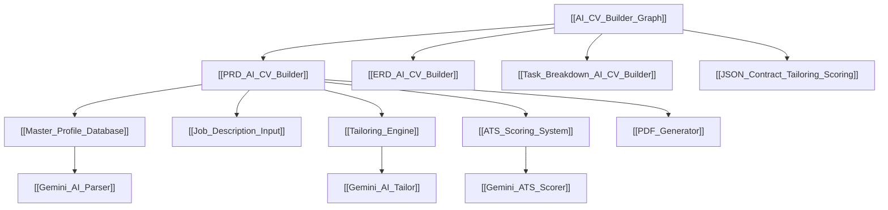

# 🧠 AI CV Builder — Knowledge Graph Hub

Selamat datang di **Knowledge Graph Hub** untuk proyek **AI-Powered CV Builder**. Note ini berfungsi sebagai pusat navigasi interaktif (*MOC - Map of Content*) yang menghubungkan seluruh spesifikasi, arsitektur database, integrasi AI, dan progres pengerjaan di Obsidian.

> [!TIP]
> **Obsidian Tip:** Tekan `Ctrl + G` (atau buka sidebar *Graph View*) di Obsidian untuk melihat keterhubungan visual antar node dalam proyek ini!

> [!IMPORTANT]
> **Database Configuration:**
> Proyek ini menggunakan `DB_CONNECTION=sqlite` sebagai database engine default.

---

## 🗺️ Project Architecture & Specs

---

## 📌 Core Modules (Knowledge Nodes)

### 1. 🗄️ Master Profile & Data Layer
- **PRD Specs:** [[PRD_AI_CV_Builder#41-in-scope]]
- **Database Schema:** [[ERD_AI_CV_Builder]]
- **Detailed Node:** [[Master_Profile_Database]]
- **Implementation Status:** [[walkthrough_epic_1]] & [[walkthrough_epic_1_lanjutan]]
- **Key Entities:**
  - `Profile` (Biodata & Kontak)
  - `Experience` & `ExperienceBullet` (Pengalaman Kerja & Bullet Points)
  - `Project` & `ProjectBullet` (Portofolio & Bullets)
  - `Education` (Riwayat Studi)
  - `Skill` (Skill Inventory & Tools)
  - `Certification` (Lisensi & Sertifikat)

### 2. 🤖 AI Parsing & Extractor Engine
- **Parser Service:** `App\Services\GeminiParserService`
- **Text Extractor:** `App\Services\TextExtractor` (Supports `.pdf` & `.docx`)
- **Detailed Node:** [[Gemini_AI_Parser]]
- **Date & Skill Sanitization:** [[cv_parser_date_and_skill_category_handling]]

### 3. 🎯 Job Description & AI Tailoring Engine
- **Input Specs:** [[Task_Breakdown_AI_CV_Builder#epic-2-job-description-input]]
- **Tailoring Prompt & JSON Contract:** [[JSON_Contract_Tailoring_Scoring]]
- **Detailed Node:** [[Tailoring_Engine]]
- **Anti-Fabrication Constraint:** Strict validation to prevent AI hallucination.

### 4. 📊 ATS Scoring System
- **Scoring Specs:** [[Task_Breakdown_AI_CV_Builder#epic-4-ats-scoring]]
- **Detailed Node:** [[ATS_Scoring_System]]
- **Metrics:** Match Percentage %, Missing Keywords, Impact Score.

### 5. 📄 Output Generation (PDF)
- **PDF Engine:** DomPDF integration
- **Detailed Node:** [[PDF_Generator]]
- **ATS Template Rules:** Single column, selectable text, ATS-friendly typography.

---

## 📈 Epic Progress Tracker

- [x] **Epic 1:** [[Master_Profile_Database]] — *Completed 100%*
- [x] **Epic 2:** [[Job_Description_Input]] — *Completed 100%*
- [x] **Epic 3:** [[Tailoring_Engine]] — *Completed 100%*
- [x] **Epic 4:** [[ATS_Scoring_System]] — *Completed 100%*
- [x] **Epic 5:** [[PDF_Generator]] — *Completed 100%*
- [x] **Epic 6:** End-to-End Flow & Polish — *Completed 100%*
- [x] **Direct PDF ATS Checker** — *Completed 100%* (Bypasses Master Profile using uploaded CV file)
- [x] **Prompt Polish #1:** Pilihan Bahasa Output — *Completed 100%* (Bahasa Indonesia & English support)
- [x] **Prompt Polish #2:** Pilihan Model AI Gemini — *Completed 100%* (Gemini 2.5 Flash & Gemini 3.1 Flash Lite)
- [x] **Mini-RAG Doc Chatbot:** [[Mini_RAG_Doc_Chatbot]] — *Completed 100%* (Vault RAG Internal Tool & Known Limitations)

---

## 🔗 Related Documentation Links
- [[PRD_AI_CV_Builder|Product Requirements Document]]
- [[ERD_AI_CV_Builder|Entity Relationship Diagram]]
- [[Task_Breakdown_AI_CV_Builder|Task Breakdown & Epics]]
- [[JSON_Contract_Tailoring_Scoring|JSON Contract for AI API]]
- [[Fitur_Tambahan_Diluar_Epic|Fitur Tambahan & Enhancements di Luar Epic Awal]]
- [[Project_Guidelines_Dos_and_Donts|Project Guidelines, Do's & Don'ts]]
- [[Mini_RAG_Doc_Chatbot|Mini-RAG Doc Chatbot Node & Known Limitations]]
