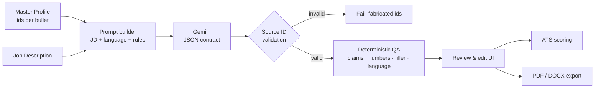

<p align="center">
  
  
  
  
  
  
</p>

<h1 align="center">AI CV Builder</h1>

<p align="center">
  A single-user CV tailoring studio: keep one <em>Master Profile</em>, paste a job description, and let Gemini rewrite the wording into a targeted, ATS-friendly CV — without ever inventing experience.
</p>

---

## Why this exists

Tailoring a CV for every job posting is slow, and "AI CV generators" usually hallucinate skills you don't have. This app treats the **Master Profile as the single source of truth**: every generated bullet is traced back to a real `source_bullet_id`, and a deterministic QA layer flags fabricated claims, invented numbers, generic filler and language mixing before you export anything.

## ✨ Features

| Feature | What it does |
|---|---|
| **Master Profile** | Single profile + experiences, education, skills, certifications, projects — all with per-bullet ids (`experience_bullets`, `project_bullets`). |
| **CV upload & AI parsing** | Upload a PDF/DOCX CV, extract text, and let Gemini structure it into the Master Profile (with a review step). |
| **AI tailoring (Call 1)** | Rewrites the summary, experience bullets and projects for a target JD, preserving real job titles and ids. |
| **Prompt tambahan (extra instructions)** | Add free-form instructions (e.g. "emphasize eagerness to learn") and re-tailor the wording on the spot. |
| **Key Projects manager** | Add/remove projects from the CV, reselect projects from the Master Profile, and re-tailor them with AI (translated + aligned to the JD). |
| **ATS scoring (Call 2)** | Match %, matched/missing keywords, per-item feedback and a suitability verdict. |
| **ATS-friendly export** | Single-column, text-selectable PDF (DomPDF) and DOCX (PHPWord) — Summary → Key Projects → Experience → Education → Skills. |
| **Instant checks** | Paste-check an existing PDF/DOCX, or pre-screen the Master Profile against a JD without mutating any data. |
| **Output language & model selection** | Bahasa Indonesia / English, and Gemini 2.5 Flash vs 3.1 Flash Lite. |
| **Mini-RAG docs Q&A** | Ask questions about the project's own `docs/` using Gemini embeddings + in-memory cosine similarity. |
| **CV Assistant Agent** | Tool-calling demo: the agent decides between `query_docs` and `get_master_profile_summary`. |

## 🧠 How the tailoring pipeline works



Everything the model returns is JSON with `source_id` / `source_bullet_id`. The engine rejects the whole response when an id does not exist in the Master Profile — so the worst case is a failed generation, never a fake company or bullet.

### Anti-hallucination guards

`TailoringEngine::validateHardConstraints()` + `TailoringEngine::checkFaithfulness()` check for:

- unknown `source_id` / `source_bullet_id` (hard fail),
- skills claimed but not present in the Master Profile,
- overclaiming words (`eliminate`, `expert`, `tingkat lanjut`, …),
- numbers/metrics that never appear in the Master Profile,
- generic filler (`highly motivated`, `proven track record`, `eager to contribute`, …),
- technologies that are not in the profile (`React`, `Kubernetes`, `AWS`, …),
- language purity: Indonesian text leaking into an English CV (and vice versa).

Warnings show up in the review screen as an **AI Quality Check** card before you save the final version.

## 🏗️ Architecture

```
app/
├── Http/Controllers/
│   ├── TailoringController.php      # JD → generate → refine → projects → finalize → score → export
│   ├── CvUploadController.php       # CV upload → Gemini parsing → master profile
│   ├── DocsQaController.php         # Mini-RAG over docs/
│   ├── AgentController.php          # tool-calling agent demo
│   └── ProfileController.php, ExperienceController.php, ... # Master Profile CRUD
├── Services/
│   ├── TailoringEngine.php          # prompt + validation + QA + project re-tailoring
│   ├── ATSScoringEngine.php         # keyword match, feedback, suitability
│   ├── GeminiParserService.php      # CV text → structured master profile
│   ├── MasterProfileFormatter.php   # payload contracts (tailoring & scoring)
│   ├── DocxGeneratorService.php     # ATS-friendly DOCX
│   ├── TextExtractor.php            # PDF (smalot/pdfparser) + DOCX extraction
│   ├── DocEmbeddingService.php      # Mini-RAG embeddings
│   └── CvAssistantAgentService.php  # tool-calling agent
└── Support/CvLocale.php             # section headers, date ranges, link filtering
```

## 🚀 Getting started

**Requirements:** PHP 8.3+, Composer, Node.js 20+, and a [Google AI Studio](https://aistudio.google.com/) API key.

```bash
# 1. Install dependencies
composer install
npm install

# 2. Environment
cp .env.example .env
php artisan key:generate

# 3. Database (SQLite by default)
touch database/database.sqlite
php artisan migrate

# 4. Gemini API key
#    .env
#    GEMINI_API_KEY=your-key
#    GEMINI_MODEL=gemini-3.1-flash-lite

# 5. Build assets & run
npm run build
php artisan serve
```

Open `http://localhost:8000`, fill in **Biodata**, add your experiences/education/skills/projects, then go to **Tailor CV (JD)**.

### Useful environment variables

| Variable | Purpose |
|---|---|
| `GEMINI_API_KEY` | Google AI Studio key (required for AI features). |
| `GEMINI_MODEL` | Default model (`gemini-3.1-flash-lite`). |
| `GEMINI_TAILORING_MODEL` / `GEMINI_SCORING_MODEL` | Optional per-call overrides. |
| `DB_CONNECTION` | `sqlite` by default; MySQL works too. |

## 🧪 Tests

```bash
php artisan test
```

**36 tests / 158 assertions** covering tailoring (incl. prompt rules, faithfulness checks, project re-tailoring), finalize + PDF/DOCX layout, and instant checks. AI calls are mocked in tests (`services.gemini.key = mock`), so the suite never hits the network.

## ⚠️ Limitations

- Single-user MVP, no authentication — deploy behind your own auth/reverse proxy if exposed.
- AI features need a Gemini API key and are subject to quota/rate limits.
- PDF layout is intentionally plain (one column, no photos) because ATS parsers read text, not design.

## 📄 License

MIT — see [LICENSE](LICENSE).
