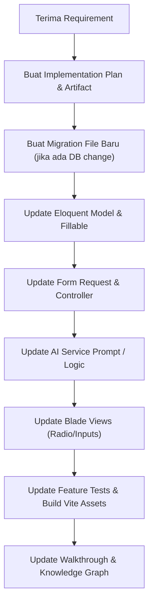

# 📋 Project Guidelines, Do's & Don'ts — AI CV Builder

Main Hub: [[AI_CV_Builder_Graph]] | Related: [[Fitur_Tambahan_Diluar_Epic]], [[PRD_AI_CV_Builder]]

Dokumen ini berisi panduan aturan pengerjaan, hal yang boleh & tidak boleh dilakukan (*Do's & Don'ts*), serta konvensi arsitektur proyek **AI CV Builder** berdasarkan pengalaman pengerjaan sesi sejauh ini.

---

## ✅ DO'S (Hal yang Sangat Dianjurkan)

### 1. Migrasi Database & Schema
* **DO:** Selalu buat **file migrasi baru bertanggal baru** saat menambahkan kolom (contoh: `output_language`, `ai_model`, `raw_cv_text`).
* **DO:** Selalu gunakan pengecekan `if (!Schema::hasColumn('table', 'column'))` di dalam method `up()` migrasi untuk mencegah crash jika migrasi dijalankan di database yang partially-migrated.
* **DO:** Selalu ingatkan pengguna untuk menjalankan `php artisan migrate` di terminal lokal mereka setelah ada file migrasi baru.

### 2. Arsitektur & Pemisahan UI (UX)
* **DO:** Pertahankan pemisahan halaman & rute terpisah untuk setiap *intent* pengguna:
  * `/pdf-checker` (`pdf-create.blade.php`) $\rightarrow$ Unggah & cek PDF eksternal secara independen.
  * `/master-check` (`master-create.blade.php`) $\rightarrow$ Pre-screening profil database aktif.
  * `/tailoring/create` (`create.blade.php`) $\rightarrow$ Alur AI Tailoring & Reframing penuh.
* **DO:** Gunakan prinsip DRY (Don't Repeat Yourself) pada pilihan UI. Definisi model AI (`AI_MODELS`) ditempatkan sebagai konstanta pada Eloquent Model `GeneratedCv`, lalu di-loop secara dinamis di Blade template.

### 3. Validasi & Integritas Request
* **DO:** Gunakan validasi `in:` dinamis dari konstanta model:
  `'ai_model' => ['required', 'string', 'in:' . implode(',', array_keys(GeneratedCv::AI_MODELS))]`.

### 4. Penanganan Fallback Data Lama
* **DO:** Pastikan semua record lama di database yang memiliki kolom `null` (seperti `ai_model = null` atau `output_language = null`) memiliki mekanisme *fallback* aman ke nilai default config (`gemini-3.1-flash-lite` dan `id`) agar aplikasi tidak pernah melempar 500 internal server error.

### 5. Persetujuan Pengguna (User Approval Mandate)
* **DO:** Setiap rencana perubahan fitur, penambahan migrasi DB, perubahan struktur arsitektur, atau penyesuaian prompt **wajib disajikan terlebih dahulu melalui Implementation Plan (`implementation_plan.md`) dan mendapatkan persetujuan eksplisit dari pengguna** sebelum agent mengeksekusi perubahan file atau perintah.

---

## ❌ DON'TS (Hal yang Harus Dihindari)

### 1. Perubahan Schema & Database
* **DON'T:** Jangan mengedit file migrasi lama yang sudah pernah dijalankan sebelumnya, karena Laravel akan melewatkan migrasi tersebut kecuali jika dilakukan `migrate:fresh` (yang akan menghapus data Master Profile pengguna).

### 2. Penataan UI Form
* **DON'T:** Jangan menumpuk dua tombol aksi instan (cek instan DB) dan tombol tailoring panjang di dalam satu halaman form yang sama tanpa kejelasan konteks visual, karena dapat membingungkan pengguna.
* **DON'T:** Jangan meng-hardcode opsi label/deskripsi radio card di dalam file Blade secara manual di banyak tempat.

### 3. Prompting & AI Constraint
* **DON'T:** Jangan merubah bahasa pada `matched_keywords` dan `missing_keywords` di `ATSScoringEngine`. Teks keyword harus selalu mempertahankan ejaan & besar-kecil huruf orisinal dari teks Job Description agar pencocokan kata kunci tetap akurat.
* **DON'T:** Jangan menghilangkan validasi `source_id` & `source_bullet_id` pada `TailoringEngine` karena validasi ini adalah benteng utama pencegah fabrikasi/halusinasi AI.

### 4. Keamanan & Privasi Environment (.env)
* **DON'T:** Dilarang membuka, membaca, atau menampilkan isi berkas sensitif `.env` / `.env.local` secara langsung menggunakan `view_file` atau perintah terminal untuk mencegah kebocoran API Key (seperti `GEMINI_API_KEY`) atau kredensial rahasia server. Pengaksesan konfigurasi harus selalu dilakukan secara aman melalui `config('services.gemini.key')` atau `env(...)` pada kode aplikasi Laravel.

---

## 📂 Ringkasan Alur Pengerjaan & Verifikasi Proyek

---

## 🔗 Related Documentation
- [[AI_CV_Builder_Graph|Knowledge Graph Hub]]
- [[Fitur_Tambahan_Diluar_Epic|Fitur Tambahan & Enhancements]]
- [[JSON_Contract_Tailoring_Scoring|JSON Contract Specs]]
